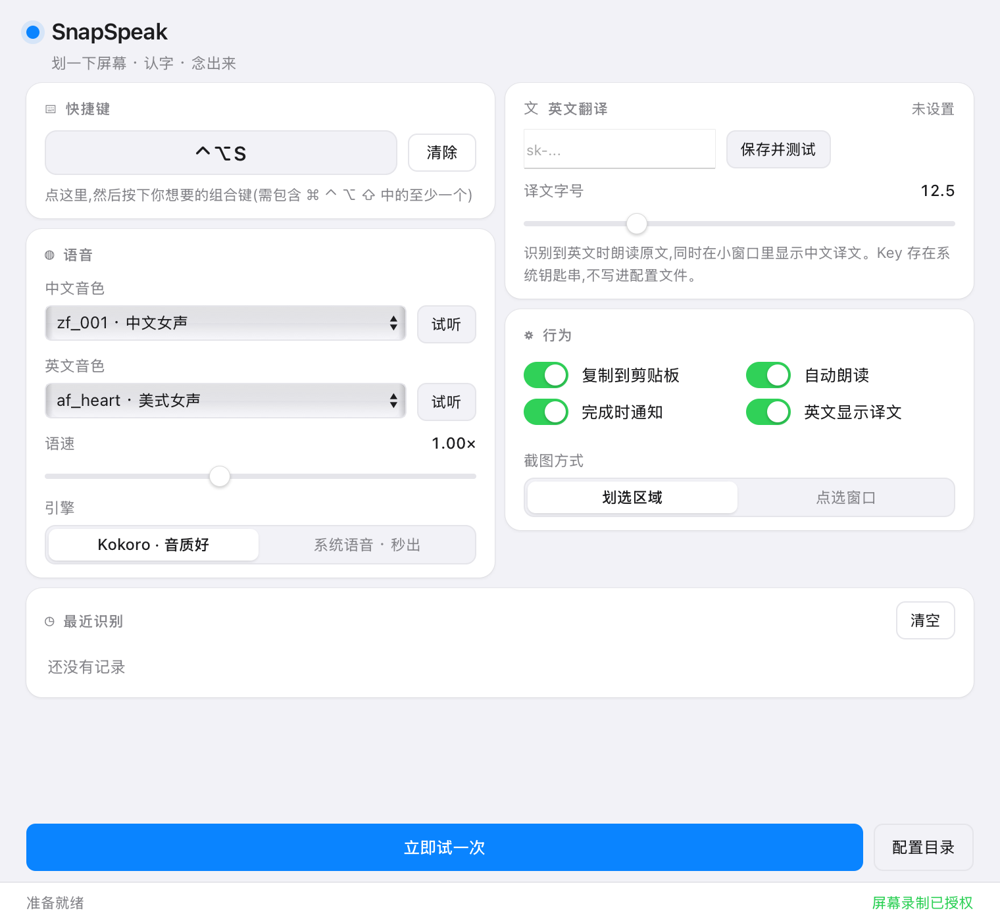
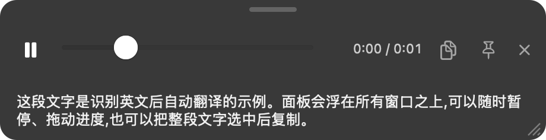

# SnapSpeak

> 划一下屏幕,认出文字,念给你听 —— 全程本地运行的 macOS 菜单栏朗读工具。


按 `⌃⌥S` → 框选屏幕上一块区域 → 它把上面的字 OCR 出来念给你听。
不用联网、不用上传截图、不用订阅。英文内容还能在旁边显示中文译文。



---

## 目录

- [为什么做这个](#为什么做这个)
- [特性](#特性)
- [快速开始](#快速开始)
- [用法](#用法)
- [它是怎么工作的](#它是怎么工作的)
- [技术选型](#技术选型)
- [性能实测](#性能实测)
- [踩过的坑](#踩过的坑)
- [隐私](#隐私)
- [兼容性与限制](#兼容性与限制)
- [项目结构](#项目结构)
- [许可证](#许可证)
- [English](#english)

---

## 为什么做这个

读论文、看幻灯片、读一堆扫描件的时候,让电脑直接念出来比用眼睛扫快得多。
但现成的方案要么把截图传到云端、要么要装一大堆依赖、要么声音机器人味很重。

这个项目的目标很简单:**按一下就念,全程离线,不装额外东西也能跑。**

---

## 特性

| | |
|---|---|
| **全本地 OCR** | macOS `Vision` 框架,和系统「实况文本」同一套模型。中英日韩等语言,带坐标和置信度 |
| **全本地 TTS** | [Kokoro-82M](https://huggingface.co/hexgrad/Kokoro-82M),82M 参数,Apache-2.0,CPU 上跑到 4~5× 实时 |
| **103 个中文音色 / 54 个英文音色** | 每个都能「试听」,不用盲猜编号 |
| **中英混读** | 中文里夹的 `ChatGPT`、`GPU` 这类词也能念出来 |
| **跨行断词修复** | 论文截图里的 `con-` / `trol` 会接回 `control`;`test-time` 这种真连字符则保留 |
| **悬浮播放条** | 暂停、拖进度、钉住、拖动、缩放、调字号 —— 而且浮在所有窗口之上 |
| **英文 → 中文译文**(可选) | 朗读英文原文,另起一个小窗显示中文译文。直接用 [DeepSeek](https://platform.deepseek.com/) API |
| **菜单栏常驻** | 不进 Dock,不抢焦点,模型常驻内存 |
| **命令行版** | `snap.sh` / `speak.sh`,能接管道、能批量 |

---

## 快速开始

### 方式一:直接下载(App,免安装环境)

到 [Releases](../../releases) 下载 `SnapSpeak-*-macOS-arm64.zip`(约 800 MB,自带 Python 和模型)。

1. 解压,把 `SnapSpeak.app` 拖进「应用程序」
2. **第一次要右键 →「打开」** —— 这个 App 没有 Apple 开发者签名,macOS 默认会拦
3. 按 `⌃⌥S`,系统弹「录制屏幕」→ 允许

> 如果右键也打不开,终端里跑:
> `xattr -dr com.apple.quarantine /Applications/SnapSpeak.app`

### 方式二:从源码跑

需要 Python **3.10 / 3.11 / 3.12**(`misaki` 目前不支持 3.13+)。

```bash
git clone https://github.com/oSaintJusto/SnapSpeak.git
cd SnapSpeak

./setup.sh          # 建 .venv + 装依赖 + 下载模型(约 720 MB)
./build_app.sh      # 打包成 ~/Applications/SnapSpeak.app
open ~/Applications/SnapSpeak.app
```

不想用 App 的话,命令行直接可用:

```bash
./speak.sh "你好,世界"
./snap.sh            # 划屏取词
```

---

## 用法

### 菜单栏

启动后没有 Dock 图标,只在菜单栏右侧出现一个声波图标。点开:

- **截图朗读** —— 立刻取词
- **快捷键 …** —— 显示当前绑定
- **设置…** —— 打开设置窗口
- **退出**

### 快捷键

默认 `⌃⌥S`。在设置里点快捷键方框,直接按新组合即可(即时生效,无需重启)。

> ⚠️ 别用 `⌘T`、`⌘S`、`⌃F` 这种常见组合。全局热键会**抢在所有 App 前面**,
> 选了 `⌘T` 以后浏览器里新建标签页都会变成截图。`⌃⌥` + 字母基本不冲突。

### 悬浮播放条

朗读时屏幕底部浮出一条,**不会抢焦点**:

```
┌──────────────────────────────────────────────┐
│ ▶  ━━━━●──────────  0:02 / 0:34   📌    ✕    │
│ 本地 OCR 让你的截图不出本机。任何东西都不会    │
│ 离开你的笔记本电脑。                          │
└──────────────────────────────────────────────┘
```



| 控件 | 作用 |
|---|---|
| ▶ / ⏸ | 暂停 / 继续 |
| 进度条 | 拖到哪儿从哪儿播 |
| 📌 | 钉住:播完不消失,方便慢慢看译文 |
| ✕ | 关闭(顺手删掉临时音频) |
| **顶部小横条** | 拖动面板,位置记住 |
| **右下角斜纹** | 缩放面板,大小记住 |

译文区是**可选中**的,选中后 `⌘C` 直接复制(识别完也已经自动进过一次剪贴板)。
拖动请用顶部那条横条——它得让位给文字选择,这就是加它的原因。

> 无边框面板默认 `canBecomeKeyWindow = NO`,文字是选不中的;
> 这里把面板换成子类并覆写该属性,同时保留 `becomesKeyOnlyIfNeeded`,
> 只有真去点文字时才抢键盘焦点,平时不打断你正在用的 App。

窗口层级是 `NSFloatingWindowLevel`,并注册了「所有 Space + 全屏 App 之上」,
所以切到浏览器、编辑器、全屏看视频,它都还在上面。

### 英文译文(可选)

在 设置 → 英文翻译 里填一个 DeepSeek API Key,点「保存并测试」。

- 朗读的**始终是英文原文**(用英文音色)
- 中文译文**只用来显示**
- 剪贴板里放的是**译文**
- Key 存进 **macOS 钥匙串**,不写进任何配置文件
- 没填 Key 或翻译失败 → 只念英文,不影响主流程

### 命令行

```bash
./speak.sh "念这句话"                    # 直接播
./speak.sh -f 论文.pdf                    # 念整个 PDF(txt/md/pdf/docx)
./speak.sh -f 文章.txt -o 文章.mp3        # 存成文件
./speak.sh "Hello" -l en -v bm_george     # 换语言和音色

./snap.sh                                 # 划屏 → OCR → 朗读
./snap.sh -w                              # 点选一个窗口
./snap.sh -p                              # 识别剪贴板里的图
./snap.sh -f 图片.png --no-play           # 只识别不朗读
./snap.sh --list-voices -l zh             # 看所有音色
```

`snap.sh --raw` 只输出纯文本,方便接管道。

### OCR 单独用

```bash
.venv/bin/python ocr.py 图片.png            # 输出纯文本
.venv/bin/python ocr.py 图片.png --json     # 带坐标和置信度
.venv/bin/python ocr.py --paste             # 识别剪贴板
```

---

## 它是怎么工作的

```
            ⌃⌥S
             │
   ┌─────────▼──────────┐
   │ screencapture -i   │  交互式区域截图
   └─────────┬──────────┘
             │  PNG(临时文件)
   ┌─────────▼──────────┐
   │ Vision             │  VNRecognizeTextRequest
   │ VNRecognizeText    │  → 按行重排、置信度过滤
   └─────────┬──────────┘
             │
   ┌─────────▼──────────┐
   │ textfix            │  接回硬换行、去掉行尾断词连字符
   └─────────┬──────────┘
             │  文本 + 语言判断
   ┌─────────▼──────────┐        ┌──────────────────┐
   │ 是不是英文?         │──是──▶│ DeepSeek 翻译     │ 只用于显示
   └─────────┬──────────┘        └──────────────────┘
             │  朗读用原文
   ┌─────────▼──────────┐
   │ Kokoro-82M (ONNX)  │  按句切块 → 音素 → 波形
   └─────────┬──────────┘
             │  24 kHz WAV
   ┌─────────▼──────────┐
   │ AVAudioPlayer      │  可暂停 / 可 seek
   └─────────┬──────────┘
             ▼
      悬浮播放条
```

关键点:

- **跨行断词**是最容易忽略的一环。截图里的正文是硬换行的,PDF 还会在行尾加断词连字符,
  原样念就会把 `con` `trol` 念成两个词。`textfix.py` 做两件事:接回同一段里的断行、
  去掉断词连字符。难点是 `con-trol`(断词)和 `test-time`(真连字符)长得一模一样,
  这里用 `/usr/share/dict/words` 判断——拼起来是个词就去掉连字符,
  两半各自都是词就保留。没有词典时退化成"一律去掉"。
- **长文本按句子切块**再拼接,块间插 0.18 秒静音,避免一口气合成导致音色漂移。
  句子过长时按**空格**回退切分,不会把单词劈成两半。
- **中文走拼音→IPA,英文走 espeak→音素**,两条 G2P 流水线,用 `misaki`
- **模型常驻内存**:首次加载约 2 秒,之后每次取词约 0.6 秒

---

## 技术选型

| 环节 | 选择 | 为什么 |
|---|---|---|
| OCR | macOS `Vision` | 系统自带、离线、中文准确率高、不用装模型 |
| TTS | Kokoro-82M | 82M 参数就够好,CPU 上跑得比实时快,Apache-2.0 |
| 推理 | ONNX Runtime | 比 PyTorch 轻得多,启动快 |
| G2P | `misaki` | Kokoro 官方配套,中文多音字处理最好 |
| 播放 | `AVAudioPlayer` | `afplay` 是子进程,没法暂停和定位 |
| 全局热键 | Carbon `RegisterEventHotKey` | **不需要「辅助功能」权限**,这点很关键 |
| 界面 | AppKit + `WKWebView` | 菜单栏原生,设置界面用 HTML 写得快也好看 |
| 桥接 | PyObjC | 不用编译,直接调系统框架 |

---

## 性能实测

Apple M4 / 10 核 / 16 GB / macOS 15:

| 场景 | 结果 |
|---|---|
| 模型加载 | 中文 1.8 s,英文 0.4 s |
| 332 字中文 → 54.5 s 音频 | 耗时 11.4 s(**4.8× 实时**) |
| OCR 一屏文字 | 0.3 ~ 0.5 s |
| 完整取词(OCR + 合成 + 起播) | 约 0.6 s(模型已热) |
| 常驻内存 | 约 700 MB |

回环验证(把合成音频再用 Whisper 认回文字):

- 英文:与原文**逐词一致**
- 中文:内容完整,只有同音字级误差(`校对/校队`),属于识别器的正常表现

---

## 踩过的坑

写这个项目踩了几个不太容易搜到的坑,记下来省得别人再踩:

**1. int8 量化模型跑不起来**

`kokoro-onnx` 提供的 `int8` ONNX 在 onnxruntime 上直接报
`Could not find an implementation for ConvInteger`。
换成 `fp32` 就好,代价是模型从 114 MB 变成 310 MB。

**2. Python 3.13 装不了中文 G2P**

`misaki` 的 `requires_python` 是 `<3.13`,系统自带的 3.13 装不上。
单独建 3.10 环境解决。

**3. PyObjC 里普通方法会被当成 ObjC selector**

`NSObject` 子类里的每个方法都会被 pyobjc 注册成 selector,
于是 `def _worker(self, source)` 会报
`'_worker' expects 0 arguments`。纯 Python 的辅助方法必须加
`@objc.python_method`。

**4. 别显式继承 PyObjC 协议**

`class Bridge(NSObject, objc.protocolNamed('WKScriptMessageHandler'))`
会触发 `metaclass conflict`。WKWebView 只按 `respondsToSelector` 调用,
不声明协议照样工作。

**5. 无边框面板里的文字会吞掉拖动事件**

想让整个面板都能拖动,`NSTextField` 必须重写 `hitTest_` 返回 `None`,
否则鼠标落在文字上就拖不动了(代价是文字不能选中复制,
不过译文本来就会自动进剪贴板)。

**6. WKWebView 快照会抓到旧的样式**

用 `takeSnapshotWithConfiguration` 抓图时,`:checked` 伪元素的样式
可能晚一帧才绘制。在 `render()` 末尾加一句 `void document.body.offsetHeight`
强制一次样式计算即可。

**7. 这台机器的 Swift 工具链编不了东西**

只装了 Command Line Tools 且 `SwiftBridging` 的 modulemap 有重复定义,
`swiftc` 直接报错。于是 OCR 改用 PyObjC 调同一个 Vision API。
`src/ocr.swift` 留了一份原生实现,有完整 Xcode 的机器可以直接编:

```bash
swiftc -O -o bin/ocr src/ocr.swift -framework Vision -framework AppKit
```

---

## 隐私

- **截图不上传**。写在临时文件里,合成完立刻删除。
- **朗读全程离线**。模型在本地,零网络请求。
- **唯一的网络请求**是你主动开启的翻译功能,只发 OCR 出来的文字给 DeepSeek。
- **API Key 存在 macOS 钥匙串**(服务名 `SnapSpeak DeepSeek`),不落在配置文件里。
- 不收集任何埋点、崩溃上报或使用统计。

---

## 兼容性与限制

- **仅支持 Apple Silicon(M1/M2/M3/M4/M5)**。依赖的 wheel 都是 `aarch64`。
  Intel Mac 需要自己换 `x86_64` 的依赖重装。
- **最低 macOS 13**。
- 中文音色是 `zf_001` 这种编号,没有名字。建议用「试听」一个个挑。
- 中英混读的英文专有名词发音受 espeak 音素转换限制,不算地道。
- 没有情感控制,不支持 `[笑]`、`[叹气]` 这类标记。
- 扫描件 PDF 需要先做 OCR 才能读。

---

## 项目结构

```
SnapSpeak/
├── app.py                # 菜单栏 App 主体(NSStatusBar + WKWebView)
├── core.py               # 无 UI 的核心:截图 / OCR / 朗读 / 翻译 / 配置
├── player.py             # 悬浮播放面板(AVAudioPlayer + 自定义拖动缩放)
├── hotkey.py             # Carbon 全局快捷键
├── translate.py          # DeepSeek 翻译(纯标准库 urllib)
├── secret.py             # API Key ↔ macOS 钥匙串
├── tts.py                # Kokoro 封装(可当库 import)
├── ocr.py                # Vision OCR 封装(可单独当 CLI 用)
├── textfix.py            # OCR 文本整理:接回硬换行、去断词连字符
├── snap.py / snap.sh     # 命令行版:截图 → OCR → 朗读
├── speak.sh              # 命令行版:朗读文字 / 文件
├── ui/                   # 设置界面(HTML + CSS + JS)
├── src/ocr.swift         # 原生 Vision OCR(Swift,可选)
├── test/                 # OCR 测试图
├── docs/                 # 截图 + 给你朋友的《使用说明》
├── setup.sh              # 一键建环境
├── download_models.sh    # 下模型
├── build_app.sh          # 打包到 ~/Applications
├── build_portable.sh     # 打包成可分发、自带 Python 的 zip
└── make_icon.py          # 生成 App 图标
```

---

## 许可证

本项目代码采用 **MIT**。

打包分发时还包含这些第三方组件,各自遵循其原许可证:

| 组件 | 许可证 |
|---|---|
| [Kokoro-82M](https://huggingface.co/hexgrad/Kokoro-82M) 模型权重 | Apache-2.0 |
| [kokoro-onnx](https://github.com/thewh1teagle/kokoro-onnx) | MIT |
| [misaki](https://github.com/hexgrad/misaki) | MIT |
| [eSpeak NG](https://github.com/espeak-ng/espeak-ng)(经 `espeakng-loader` 分发) | **GPL-3.0** |
| CPython(便携包中) | PSF License |

> 注意:`build_portable.sh` 打出来的包里含 eSpeak NG(GPL-3.0)。
> 如果你要再分发那个 zip,需要同时提供 eSpeak NG 的源码或获取方式。

---

## English

**SnapSpeak** is a tiny macOS menu-bar app: hit `⌃⌥S`, drag a rectangle over
anything on screen, and it reads it aloud.

- **Local OCR** via Apple's Vision framework
- **Local TTS** via Kokoro-82M (82M params, runs faster than real-time on CPU)
- **Floating player** with pause / seek / pin / drag / resize, always on top
- **Optional Chinese translation** of English text through DeepSeek — displayed only, the English original is what gets spoken
- 103 Chinese voices, 54 English voices
- Zero network calls unless you enable translation

Apple Silicon only, macOS 13+. Python 3.10–3.12 for building from source.

```bash
./setup.sh        # create venv, install deps, download models
./build_app.sh    # bundle into ~/Applications
```
